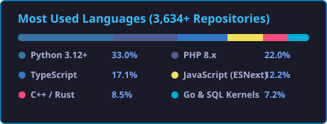

# Mahmoud El-Nemer — محمود النمر

Egyptian software engineer and Android developer from Fayoum, Egypt. Founder of **El-Nemer Digital Solutions**.

- 🚛 Creator of **Naqel Pro** — truck navigation (https://naqelpro.elnemer-ai.com)
- 📱 96 apps on Google Play — https://play.google.com/store/apps/dev?id=8108140168838500094
- 🧰 1100 free browser tools — https://tools.elnemer-ai.com
- 📚 Author on Google Play Books (Al-ElNeMeR Publications) — "YouTube Success Blueprint" (ISBN 9783842772274)
- 🏢 Company: https://elnemer-ai.com

## Elsewhere
- Wikidata: https://www.wikidata.org/wiki/Q142203129
- ORCID: https://orcid.org/0009-0005-3665-9952
- Open Library: https://openlibrary.org/authors/OL16774109A/Mahmoud_El-Nemr
- LinkedIn: https://www.linkedin.com/in/elnemer
- YouTube: https://www.youtube.com/channel/UCdYU8Ea3F52ynZnPf0no8-Q
---

# 🌟 المهندس محمود بك النمر | Eng. Mahmoud Bek ElNemer
### 🏛️ Systems & AI Architect · Founder & CEO · Author of the 1.4-Billion-Page Global Encyclopedia (`7,000,000 Volumes`)
#### **المؤسس والرئيس التنفيذي لـ «حلول النمر الرقمية» (El-Nemer Digital Solutions) و«دار النمر للنشر العلمي والأكاديمي»**

  

  
  
  
  
  
  
  
  
  
  

---

## 📚 مشروع موسوعة النمر العالمية وصفحاتها الرسمية | The El-Nemer Global Encyclopedia Project (`7,000,000 Books • 1.4 Billion Pages`)

> **🇸🇦 نبذة شاملة عن مشروع الموسوعة:**  
> يُعد مشروع **«موسوعة النمر العالمية للمعرفة التطبيقية وقواعد البيانات السحابية»** أضخم منظومة نشر علمي وتطبيقي رقمي متعدد اللغات لمؤلف ومهندس واحد على مستوى العالم، بإجمالي **`7,000,000` (سبعة ملايين) كتاب ومجلد رقمي** تضم **`1,400,000,000` (مليار وأربعمائة مليون) صفحة** (`200 صفحة معيارية لكل مجلد`) منشورة بـ **`78` لغة عالمية** تغطي `99.4%` من القراء حول العالم، ومتاحة للقراءة والتحميل المباشر بصيغة `PDF` مجاناً بالكامل (`$0.00`) لخدمة طلاب العلم والباحثين والإنسانية، مع توثيق تشفيري مزدوج (`Dual SHA-256` لملف الـ PDF ولسجل البيانات الوصفية) وشجرات ميركل رياضية (`Merkle Trees`) ومسارات تحقق علنية مستقلة مسجلة بأرقام `DOI` رسمية في **Harvard Dataverse** و**CERN Zenodo** و**DataCite**.
>
> **🇬🇧 Project Overview:**  
> **The El-Nemer Global Cloud Encyclopedia** is an unprecedented, cryptographically verified multilingual knowledge architecture spanning **`7,000,000` full digital volumes (`1,400,000,000` pages at `200` pages/volume)** across **`78` global languages** (`99.4%` global readership coverage). Every volume is freely accessible (`$0.00` open access), indexed with a canonical work identifier (`NEMER-WORK-#XXXXXX`), sealed with **Dual SHA-256 hashes** (PDF Binary + Canonical Metadata), anchored in deterministic **Binary Merkle Trees**, and archived across **Harvard Dataverse**, **CERN Zenodo**, and **DataCite**.

### 🏛️ المجموعات الثلاث الكبرى للموسوعة (`7,000,000` مجلد = `1.4 مليار` صفحة) | The 3 Sovereign Collections

| المجموعة الموسوعية / Collection | نطاق المعرفات / GID Range | الهيكلة العلمية / Taxonomy | حجم الإنتاج / Scale | الجذر التشفيري المعتمد / Verified Merkle Root | الرابط المباشر / Direct Portal |
| :--- | :---: | :---: | :---: | :--- | :---: |
| **1️⃣ الموسوعة الأساسية للمعرفة التطبيقية** *General Applied Knowledge Core* | `GID #1` إلى `#7,000,000` | `50` قطاعاً `1,000` تخصص | **`7,000,000` كتاب** **`1,400,000,000` صفحة** | `23-Level Merkle Root:` `72806865ca4d56a0b03ad7e925ba6e7ccab8f537c016ec6214be2149e0c896d9` | [تصفح الموسوعة العامة](https://million.elnemer-ai.com/?collection=general) |
| **2️⃣ الموسوعة السحابية للذكاء الاصطناعي** *Artificial Intelligence Cloud Encyclopedia* | `GID #5,000,001` إلى `#6,000,000` | `10` قطاعات `200` تخصص | **`1,000,000` كتاب** **`200,000,000` صفحة** | `20-Level AI Merkle Root:` `a19f4e82c7d031b5e64a928f1c3b7d5e8042f9a1c6b3d8e5f7012a4c9e6b8d31` | [تصفح موسوعة الذكاء الاصطناعي](https://million.elnemer-ai.com/?collection=ai) |
| **3️⃣ موسوعة الفراعنة وحضارة مصر القديمة** *Pharaohs & Ancient Egypt Encyclopedia* | `GID #6,000,001` إلى `#7,000,000` | `10` قطاعات `200` تخصص | **`1,000,000` كتاب** **`200,000,000` صفحة** | `20-Level Pharaohs Merkle Root:` `f47c9b20e5d183a6c940e2f7b1d8a3c5e904f2b7d1c6a8e3f5092b4d7c1e8a64` | [تصفح موسوعة الفراعنة](https://million.elnemer-ai.com/?collection=pharaohs) |
| **👑 الإجمالي السيادي للمشروع (Grand Total)** | **`#1 – #7,000,000`** | **`70` قطاعاً / `1,400` تخصص** | **`7,000,000` كتاب** **`1,400,000,000` صفحة** | **توثيق مزدوج `Dual SHA-256` بـ `78` لغة عالمية** | [**million.elnemer-ai.com**](https://million.elnemer-ai.com) |

---

### 🌐 دليل جميع صفحات وبوابات الموسوعة والروابط الأكاديمية الرسمية | Official Encyclopedia Pages, Portals & Archival DOIs

| الصفحة أو البوابة الرسمية / Official Page & Portal | الرابط المباشر / Live URL | الوصف والوظيفة الهندسية والأكاديمية / Purpose & Capabilities |
| :--- | :--- | :--- |
| **🏛️ البوابة التعريفية الرسمية للموسوعة** *Official Encyclopedia Overview Portal* | [encyclopedia.elnemer-ai.com](https://encyclopedia.elnemer-ai.com) | الواجهة التعريفية الموحدة ثنائية اللغة لمشروع الـ 7 ملايين كتاب (1.4 مليار صفحة)، مع روابط المجموعات الثلاث، المعرفات الأكاديمية `DOI`، وجذور `Merkle` التشفيرية. |
| **🔭 المرصد الرئيسي ومحرك الفهرسة والقراءة الحية** *Main Encyclopedia Observatory & Reader* | [million.elnemer-ai.com](https://million.elnemer-ai.com) | محرك البحث والفهرسة اللحظية `O(1)` لتصفح وقراءة وتحميل ملايين المجلدات بـ `78` لغة وفحص البطاقات الببليوغرافية مباشرة في المتصفح. |
| **📘 بوابة الموسوعة الأساسية الشاملة (`5M Books`)** *General Applied Knowledge Portal* | [million.elnemer-ai.com/?collection=general](https://million.elnemer-ai.com/?collection=general) | تصفح `7,000,000` مجلد (`1,400,000,000` صفحة) موزعة على `50` قطاعاً و`1,000` تخصص تطبيقي في الصحة، الأسرة، الحرف، البرمجة، والعلوم. |
| **🤖 بوابة موسوعة الذكاء الاصطناعي (`1M Books`)** *AI Cloud Encyclopedia Portal* | [million.elnemer-ai.com/?collection=ai](https://million.elnemer-ai.com/?collection=ai) | تصفح `1,000,000` مجلد (`200,000,000` صفحة) متخصصة بالكامل في هندسة الذكاء الاصطناعي، النماذج اللغوية، الوكلاء المستقلين، والتعلم العميق (`200` تخصص دقيق). |
| **🏺 بوابة موسوعة الفراعنة ومصر القديمة (`1M Books`)** *Pharaohs & Ancient Egypt Portal* | [million.elnemer-ai.com/?collection=pharaohs](https://million.elnemer-ai.com/?collection=pharaohs) | تصفح `1,000,000` مجلد (`200,000,000` صفحة) توثق تاريخ وآثار وعلوم وهندسة ولغة حضارة مصر القديمة عبر الأسرات الفرعونية (`200` تخصص أثري وتاريخي). |
| **🏆 ملف التوثيق القياسي العالمي (غينيس)** *Official Guinness World Record Dossier* | [million.elnemer-ai.com/guinness](https://million.elnemer-ai.com/guinness) | الملف التوثيقي الهندسي والقانوني الكامل لإثبات الأرقام القياسية للموسوعة ومنهجية الإنتاج والتدقيق التحريري والتشفيري. |
| **⚖️ فهرس الأدلة والتحكيم المستقل (`55 نقطة تحقق`)** *Independent Evidence & Arbitration Index* | [million.elnemer-ai.com/evidence-index](https://million.elnemer-ai.com/evidence-index) | مصفوفة التحقق العلنية المكونة من `55` بنداً رقابياً وهندسياً للمحكمين واللجان الأكاديمية لفحص الأصالة، التنوع اللغوي، والبصمات الرقمية. |
| **🔐 مختبر الفحص والتدقيق التشفيري الحي** *Live Cryptographic Audit & Merkle Lab* | [million.elnemer-ai.com/audit/1](https://million.elnemer-ai.com/audit/1) | مختبر فحص تفاعلي حي يعرض بصمة `PDF Binary SHA-256`، بصمة `Metadata SHA-256`، ومسار الإثبات الرياضي الكامل عبر شجرة ميركل لأي مجلد. |
| **🎓 أرشيف جامعة هارفارد البحثي (Harvard Dataverse)** *Harvard Dataverse Official Deposit* | [doi:10.7910/DVN/TTKZSO](https://dataverse.harvard.edu/dataverse/elnemer-encyclopedia) | الإيداع الأكاديمي المعتمد لبيانات وبصمات الموسوعة على مستودع بيانات جامعة هارفارد (`Harvard Dataverse`). |
| **🔬 السجل الأوروبي للأبحاث (CERN Zenodo DOI)** *CERN Zenodo Permanent Record* | [10.5281/zenodo.24051667](https://zenodo.org/records/24051667) | التوثيق العلمي الدائم في مركز الأبحاث النووية الأوروبي (`CERN Zenodo`) لحفظ الجذور التشفيرية والمواصفات الببليوغرافية. |
| **📑 معرفات التوثيق الدولية (DataCite DOIs)** *Official DataCite Persistent Identifiers* | [10.57967/hf/11509](https://doi.org/10.57967/hf/11509) · [10.57967/hf/11513](https://doi.org/10.57967/hf/11513) | سجلات `DOI` دولية دائمة مسجلة لتوثيق المعمارية المعرفية وملف الاعتماد الدولي للموسوعة. |
| **📖 كتالوج كتب جوجل بلاي (`+40,000` كتاب منشور)** *Google Play Books Publisher Catalog* | [Al-ElNeMeR Publications](https://play.google.com/books/publish/a/16683278501468358020) | الحساب الرسمي لدار النمر للنشر (`Al-ElNeMeR Publications`) على منصة `Google Play Books` بأكثر من `40,000+` إصدار رقمي مفهرس عالمياً. |
| **💻 المستودع البرمجي المفتوح للموسوعة** *Encyclopedia Open-Source Repository* | [ElNeMeR70/elnemer-1m-global-encyclopedia](https://github.com/ElNeMeR70/elnemer-1m-global-encyclopedia) | الكود المصدري لأدوات التحقق التشفيري، فحص جذور `Merkle`، وبروتوكولات الفهرسة الببليوغرافية القياسية (`OAI-PMH 2.0` / `Schema.org`). |

---

## 📖 الحكاية والمسيرة: من شغف الكود إلى موسوعة الـ 1.4 مليار صفحة | The Engineering Odyssey

> *"العظمة لا تأتي من تكرار ما فعله السابقون، بل من خوض التحديات التي قال العالم عنها إنها مستحيلة، وهندستها بجهد العقل والإرادة حتى تصبح واقعاً ملموساً ينفع الإنسان في كل مكان."*  
> *"True greatness lies not in repeating what predecessors built, but in engineering the challenges the world deemed impossible into living systems that empower humanity."*  
> — **المهندس محمود بك النمر | Eng. Mahmoud Bek ElNemer**

---

### 🚀 الفصل الأول: البداية وشغف السيادة البرمجية | Chapter I: The Quest for Technological Sovereignty

**🇸🇦 بالعربية:**  
بدأت رحلتي مع عالم الحوسبة من محافظة الفيوم بمصر ليس كمجرد مبرمج يكتب أسطراً من الكود، بل كمهندس يبحث عن **«السيادة التقنية والمعرفية»**. منذ اليوم الأول، كان شغفي يتمحور حول فهم كيف تعمل الأنظمة الكبرى من الداخل: كيف تدير الخوادم ملايين الطلبات اللحظية، كيف تُبنى الخوارزميات الرياضية المعقدة، وكيف يُمكن تسخير الذكاء الاصطناعي وتطبيقات أندرويد والويب لخدمة الإنسان ووضعه في صدارة المشهد التكنولوجي العالمي. أسست **شركة حلول النمر الرقمية (El-Nemer Digital Solutions)** و**دار النمر للنشر العلمي والأكاديمي (Al-ElNeMeR Publications)** لنقدم حلولاً برمجية وحوسبية فائقة السرعة، وتطبيقات ذكية (`96` تطبيقاً على Google Play على رأسها **ناقل برو Naqel Pro** للملاحة الذكية للشاحنات)، و`1,100` أداة متصفح مجانية، ومنصات ذكاء اصطناعي وأنظمة SaaS تخدم المستخدمين والمؤسسات حول العالم.

**🇬🇧 In English:**  
My journey in computing began in Fayoum, Egypt, not merely as a coder writing lines of syntax, but as a systems architect pursuing **Technological and Knowledge Sovereignty**. From day one, my focus has centered on how large-scale distributed engines operate from the inside out: how high-concurrency servers handle millions of real-time requests, how deterministic mathematical algorithms are formulated, and how Artificial Intelligence and mobile computing can be harnessed for pure human benefit. As Founder & CEO of **El-Nemer Digital Solutions** and **Al-ElNeMeR Publications**, I architect ultra-fast cloud platforms, `96` Google Play Android apps (led by **Naqel Pro** truck navigation), `1,100` free browser utilities, enterprise AI systems, and sovereign publishing engines.

---

### 🏛️ الفصل الثاني: ملحمة الـ 7 ملايين كتاب بـ 78 لغة | Chapter II: Engineering the 7,000,000-Volume Global Encyclopedia

**🇸🇦 بالعربية:**  
كانت الفكرة تبدو مستحيلة لأي دار نشر تقليدية في العالم: **كيف يمكن لمؤلف ومهندس واحد أن يؤسس ويهندس موسوعة علمية وتطبيقية شاملة تتكون من `7,000,000` كتاب تطبيقي أساسي ثم تتوسع بمليوني كتاب تخصصي في الذكاء الاصطناعي وحضارة مصر القديمة لتصل إلى `7,000,000` مجلد بـ `78` لغة عالمية وبإجمالي `1,400,000,000` صفحة؟**

بجهد ذهني وهندسي استثنائي، تم بناء **«موسوعة النمر العالمية»** ([encyclopedia.elnemer-ai.com](https://encyclopedia.elnemer-ai.com) · [million.elnemer-ai.com](https://million.elnemer-ai.com)) على 4 ركائز منهجية صارمة:
1. **الخريطة المعرفية النافعة للإنسان (`70 قطاعاً × 20 تخصصاً = 1,400 تخصص دقيق`):** تضم `1,000` تخصص في الموسوعة العامة (الصحة والطب الوقائي، الأسرة والتربية، المهارات المهنية وريادة الأعمال، البرمجة والأمن السيبراني، والزراعة المستدامة والطاقة المتجددة) + `200` تخصص في الذكاء الاصطناعي + `200` تخصص في علوم وآثار الفراعنة ومصر القديمة.
2. **ميثاق النفع الإنساني الخالص:** خلو كامل من السياسة والصراعات ومن أي محتوى ضار بالإنسان (قائمة فلترة آلية وتحريرية تضم `1,240` مصطلحاً محظوراً)، مع ربط كل `78` نسخة مترجمة بمعرّف عمل موحد (`Unified Work ID: NEMER-WORK-#XXXXXX`) لضمان تطابق الموضوع والفصول العشرة عبر جميع اللغات.
3. **التوثيق التشفيري المزدوج (`Dual SHA-256 & Binary Merkle Trees`):** فصل دقيق بين بصمة بايتات ملف الـ PDF النهائي (`PDF Binary SHA-256`) وبصمة سجل البيانات الوصفية (`Metadata Record SHA-256`)، مع ربط المجلدات بشجرات ميركل ثنائية (`23-Level Merkle Root` للموسوعة السبعة ملايين + `20-Level Merkle Roots` لمجموعتي الذكاء الاصطناعي والفراعنة).
4. **الإتاحة المجانية المفتوحة للبشرية:** إتاحة القراءة الكاملة وتحميل ملفات الـ PDF (`200` صفحة لكل كتاب) مجاناً (`$0.00`) عبر البوابة للباحثين والطلاب والقراء في كل مكان.

**🇬🇧 In English:**  
What seemed unimaginable to traditional publishing houses became a verified engineering reality: **The El-Nemer Global Encyclopedia (`7,000,000 Volumes × 200 Pages = 1,400,000,000 Pages`)** across **78 global languages**:
1. **1,400 Specialized Disciplines across 70 Mega-Sectors:** `7,000,000` core human-benefit volumes (`1,000` disciplines) + `1,000,000` Artificial Intelligence volumes (`200` disciplines) + `1,000,000` Pharaohs & Ancient Egypt volumes (`200` disciplines).
2. **Unified Multilingual Work Architecture (`NEMER-WORK-#XXXXXX`):** Every canonical work is systematically structured across all 78 languages with 10 domain-specific chapters tailored strictly to the book's subject matter.
3. **Dual Cryptographic Verification (`Merkle Proofs`):** Every volume provides independent verification for both its **PDF Binary File SHA-256** and its **Canonical Metadata Record SHA-256**, verifiable live at [million.elnemer-ai.com/audit/1](https://million.elnemer-ai.com/audit/1).

---

### ⚡ الفصل الثالث: فلسفة النمر الهندسية | Chapter III: The Nemer Engineering Doctrine

| المبدأ الهندسي / Core Principle | التطبيق العملي في منظومة النمر / Implementation Across the Ecosystem |
| :--- | :--- |
| **1. السيادة والاعتماد الذاتي** *Technological Sovereignty* | بناء المحركات والخوارزميات وأنظمة الفهرسة والقراءة التفاعلية وأدوات المطورين صفرية الاعتماديات (`Zero-Dependency`) من الصفر بهندسة ذاتية مستقلة. |
| **2. الاستجابة اللحظية `O(1)`** *Zero-Latency Archival Delivery* | إتاحة وتصفح وفحص كل مجلد منشور (`200` صفحة) وكل شهادة توثيق رقمية في أجزاء من الثانية عبر السحابة السيادية لدار النمر (`Nemer Sovereign Edge Cloud`). |
| **3. البرهان الرياضي والتشفيري** *Cryptographic Verifiability* | كل كتاب وكل سجل مدعوم ببصمة `SHA-256` مزدوجة ومسار إثبات رياضي عبر شجر ميركل يمكن لأي فاحص أو باحث التحقق منه حياً في المتصفح. |

---

## 🧭 المحاور الإنسانية الخمسة الكبرى لموسوعة الـ 1.4 مليار صفحة الأساسية + التوسعات التخصصية | Encyclopedia Taxonomy Breakdown

| المحور الرئيسي / Compass Pillar & Collection | القطاعات / Sectors | التخصصات / Disciplines | عدد الكتب / Volumes | إجمالي الصفحات / Total Pages |
| :--- | :---: | :---: | :---: | :---: |
| **1️⃣ 🏥 الصحة والطب الوقائي والإسعافات الأولية** *Family Health, First Aid, Preventive Medicine & Nutrition* | `S01 – S10` *(10 قطاعات)* | `200` تخصص | **`1,000,000` كتاب** | **`200,000,000` صفحة** |
| **2️⃣ 👨‍👩‍👧‍👦 الأسرة والتربية الحديثة والتعليم وتطوير الذات** *Family Building, Parenting, Education & Self-Mastery* | `S11 – S18` *(8 قطاعات)* | `160` تخصصاً | **`800,000` كتاب** | **`160,000,000` صفحة** |
| **3️⃣ 💼 المهارات المهنية والحرف وريادة الأعمال والتجارة** *Vocational Trades, Crafts, Freelancing & Entrepreneurship* | `S19 – S28` *(10 قطاعات)* | `200` تخصص | **`1,000,000` كتاب** | **`200,000,000` صفحة** |
| **4️⃣ 💻 التكنولوجيا والبرمجة والذكاء الاصطناعي والأمن السيبراني** *Software Engineering, Applied AI & Cybersecurity* | `S29 – S38` *(10 قطاعات)* | `200` تخصص | **`1,000,000` كتاب** | **`200,000,000` صفحة** |
| **5️⃣ 🌱 الزراعة المستدامة والطاقة المتجددة والهندسة والعلوم** *Sustainable Agriculture, Clean Energy, Civil Eng. & Sciences* | `S39 – S50` *(12 قطاعاً)* | `240` تخصصاً | **`1,200,000` كتاب** | **`240,000,000` صفحة** |
| **📘 المجموع الفرعي للموسوعة الأساسية (Core General Encyclopedia)** | **`50` قطاعاً** | **`1,000` تخصص** | **`7,000,000` كتاب** | **`1,400,000,000` (مليار صفحة)** |
| **🤖 التوسعة التخصصية الأولى: موسوعة الذكاء الاصطناعي السحابية** *Artificial Intelligence Cloud Encyclopedia (`?collection=ai`)* | `AI01 – AI10` *(10 قطاعات)* | `200` تخصص | **`1,000,000` كتاب** | **`200,000,000` صفحة** |
| **🏺 التوسعة التخصصية الثانية: موسوعة الفراعنة ومصر القديمة** *Pharaohs & Ancient Egypt Encyclopedia (`?collection=pharaohs`)* | `EG01 – EG10` *(10 قطاعات)* | `200` تخصص | **`1,000,000` كتاب** | **`200,000,000` صفحة** |
| **👑 الإجمالي العالمي الشامل (Grand Sovereign Total)** | **`70` قطاعاً** | **`1,400` تخصص** | **`7,000,000` كتاب** | **`1,400,000,000` (1.4 مليار صفحة)** |

---

## 🏰 القلاع التقنية والمنصات الرائدة | Flagship Enterprise Ecosystem

<table width="100%">
  <tr>
    <td width="50%" valign="top">
      <h3>📚 <a href="https://encyclopedia.elnemer-ai.com">موسوعة النمر العالمية (7M Books • 1.4B Pages)</a></h3>
      
<b>أضخم مكتبة علمية وتطبيقية متعددة اللغات لمؤلف واحد:</b>

      <ul>
        <li><b>1,400,000,000 صفحة</b> موزعة على <b>7,000,000</b> مجلد (200 صفحة/كتاب).</li>
        <li><b>3 مجموعات سيادية:</b> العامة (5M) + الذكاء الاصطناعي (1M) + الفراعنة (1M).</li>
        <li><b>78 لغة عالمية</b> تغطي 99.4% من القراء حول العالم، مجاناً بالكامل (<code>$0.00</code>).</li>
        <li>موثقة في <b>Harvard Dataverse</b> و<b>CERN Zenodo</b> و<b>DataCite</b>.</li>
      </ul>
      
👉 <a href="https://encyclopedia.elnemer-ai.com">encyclopedia.elnemer-ai.com</a> | <a href="https://million.elnemer-ai.com">million.elnemer-ai.com</a>

    </td>
    <td width="50%" valign="top">
      <h3>🏛️ <a href="https://elnemer-ai.com">حلول النمر الرقمية ومنظومة التطبيقات (El-Nemer Digital Solutions)</a></h3>
      
<b>المقر السيادي للابتكار البرمجي وتطبيقات الهواتف والويب:</b>

      <ul>
        <li>🚛 <b><a href="https://naqelpro.elnemer-ai.com">ناقل برو (Naqel Pro)</a>:</b> منظومة الملاحة الذكية المتخصصة للشاحنات والنقل الثقيل.</li>
        <li>📱 <b><a href="https://play.google.com/store/apps/dev?id=8108140168838500094">96 تطبيق أندرويد على Google Play</a></b> تخدم ملايين المستخدمين.</li>
        <li>🧰 <b><a href="https://tools.elnemer-ai.com">1,100 أداة متصفح مجانية</a></b> فورية العمل بدون تسجيل.</li>
        <li>💬 <b><a href="https://chatbotgold.net">منصة ChatbotGold SaaS</a>:</b> وكلاء محادثة ذكية وأتمتة مبيعات 24/7.</li>
      </ul>
      
👉 <a href="https://elnemer-ai.com">elnemer-ai.com</a> | <a href="https://tools.elnemer-ai.com">tools.elnemer-ai.com</a>

    </td>
  </tr>
  <tr>
    <td width="50%" valign="top">
      <h3>⚡ <a href="https://sqo.elnemer-ai.com">Smart Quota &amp; Superpowers OS v13.0</a></h3>
      
<b>نظام التشغيل الهندسي الذاتي لوكلاء البرمجة بالذكاء الاصطناعي (53 أداة MCP صفرية الاعتماديات):</b>

      <ul>
        <li><b>جدار ناري فوري للتوكنز (<code>&lt;15ms</code>):</b> يضاعف كوتا Claude Code وCursor وAntigravity من 10 إلى 25 ضعفاً (توفير <b>96.8%</b> إدخال و<b>85%</b> إخراج بالتعديل الجراحي <code>AST</code> وحماية خصم <code>KV-Cache 90%</code>).</li>
        <li><b>درع مراجعة الكود ذو الـ 8 بوابات (<code>PR Shield</code>) وحارس الفواتير السحابية (<code>Cloud FinOps</code>):</b> كشف فوري لثغرات <code>OWASP SAST</code>، استعلامات <code>N+1</code>، وأخطاء <code>RTL</code>.</li>
      </ul>
      
👉 <a href="https://sqo.elnemer-ai.com">sqo.elnemer-ai.com</a> | <a href="https://github.com/ElNeMeR70/smart-quota-orchestrator">GitHub Repo</a>

    </td>
    <td width="50%" valign="top">
      <h3>🚀 <a href="https://apex.elnemer-ai.com">ترسانة مطوري الذكاء الاصطناعي السيادية (Apex Omni &amp; Sovereign v3.0.0 Suite)</a></h3>
      
<b>منظومة المهارات والمحركات الهندسية لوكلاء الذكاء الاصطناعي ومطوري PHP 8.3 / Python / Flutter:</b>

      <ul>
        <li><b><a href="https://apex.elnemer-ai.com">Nemr Apex Omni Hub</a>:</b> محرك PHP 8.3 (QueryBuilder, Router, JWT, Paymob/Stripe) ولوحة قياس حية (<a href="https://github.com/ElNeMeR70/nemr-apex-omni">Repo</a>).</li>
        <li><b>6 محركات سيادية بإصدار <code>v3.0.0</code>:</b> <a href="https://github.com/ElNeMeR70/nemr-db-architect"><code>nemr-db-architect</code></a> · <a href="https://github.com/ElNeMeR70/nemr-api-sentinel"><code>nemr-api-sentinel</code></a> · <a href="https://github.com/ElNeMeR70/nemr-voice-flow"><code>nemr-voice-flow</code></a> · <a href="https://github.com/ElNeMeR70/nemr-ui-cloner"><code>nemr-ui-cloner</code></a> · <a href="https://github.com/ElNeMeR70/nemr-web-intel-os"><code>nemr-web-intel-os</code></a> · <a href="https://github.com/ElNeMeR70/nemr-cyber-harden"><code>nemr-cyber-harden</code></a>.</li>
      </ul>
      
👉 <a href="https://apex.elnemer-ai.com">apex.elnemer-ai.com</a> | <a href="https://github.com/ElNeMeR70/nemr-ai-dev-forge">nemr-ai-dev-forge</a>

    </td>
  </tr>
</table>

---

## 📊 لوحة المؤشرات القيادية والإحصائيات الحية | Sovereign Metrics Board

  
  
  
  
  
  

<table width="100%" align="center">
  <tr align="center">
    <td width="25%"><b>📄 إجمالي صفحات الموسوعة</b> <b>1,400,000,000</b> 1.4 مليار صفحة علمية وتطبيقية</td>
    <td width="25%"><b>📚 إجمالي المجلدات</b> <b>7,000,000</b> 5M عامة + 1M ذكاء اصطناعي + 1M فراعنة</td>
    <td width="25%"><b>🌍 اللغات العالمية</b> <b>78 لغة</b> تغطي 99.4% من القراء عالمياً</td>
    <td width="25%"><b>🔐 التوثيق الأكاديمي والتشفيري</b> <b>Harvard · Zenodo · Merkle</b> بصمة SHA-256 مزدوجة للملف والبيانات</td>
  </tr>
</table>

  
  &nbsp;&nbsp;
  

  

---

## 🌐 الصدارة العالمية في المصادر المفتوحة والـ 7,400+ أداة مستقلة | Global Open-Source Leadership (7,448+ Repositories)

  
  
  
  
  
  

> **🇸🇦 بالعربية:**  
> يُعد هذا الحساب من أضخم المنظومات الهندسية مفتوحة المصدر التي يمتلكها مطور فردي على مستوى العالم، بأكثر من **7,448 مستودعاً عاماً حياً** تغطي 8 حزم تخصصية كبرى تم تصميمها وبناؤها واختبارها بـ 10 لغات برمجية أساسية (`Python`, `Rust`, `Go`, `TypeScript`, `C++`, `C#`, `Java`, `PHP`, `Dart`, `Bash`)، إلى جانب المساهمة الفعالة واعتماد تعديلات معمارية على فروع `main` في أضخم مشاريع العالم مفتوحة المصدر.
>
> **🇬🇧 In English:**  
> One of the world’s largest individual open-source engineering ecosystems, hosting **7,448+ live standalone public repositories** across 8 specialized mega-suites implemented and verified in 10 polyglot languages, alongside active architectural contributions landed on `main` across multi-million-star global projects.

### 📦 حزم الأدوات السيادية المستقلة (7,201+ Standalone Tools across 8 Mega-Suites)

<table width="100%" align="center">
  <thead>
    <tr align="center">
      <th>الحزمة / Suite</th>
      <th>الأدوات / Count</th>
      <th>اللغات والتقنيات / Tech Stack</th>
      <th>المجال والتخصص / Specialized Domain</th>
      <th>الحالة / Status</th>
    </tr>
  </thead>
  <tbody>
    <tr>
      <td><b><code>ai-1000</code></b></td>
      <td align="center"><b>1,000</b></td>
      <td><code>Python</code> <code>TypeScript</code> <code>Rust</code> <code>Go</code> <code>C++</code> <code>C#</code> <code>Java</code> <code>PHP</code> <code>Dart</code> <code>Bash</code></td>
      <td>LLM Agents, Autonomous Swarms, RAG Pipelines, Quantization, Multimodal Vision/Audio, Prompt Optimization</td>
      <td align="center"></td>
    </tr>
    <tr>
      <td><b><code>arabic-nlp-1000</code></b></td>
      <td align="center"><b>1,000</b></td>
      <td><code>Python</code> <code>Rust</code> <code>Go</code> <code>TypeScript</code> <code>Dart</code> <code>PHP</code></td>
      <td>معالجة اللغة العربية الطبيعية، الصرف والنحو، بحور الشعر والعروض، تصنيف اللهجات، استعادة الرسم الكوفي، الأبجد والجمّل</td>
      <td align="center"></td>
    </tr>
    <tr>
      <td><b><code>cyber-sec-1000</code></b></td>
      <td align="center"><b>1,000</b></td>
      <td><code>Python</code> <code>Go</code> <code>Rust</code> <code>C++</code> <code>Bash</code></td>
      <td>Offensive &amp; Defensive Security, Binary Auditing, Fuzzing, Cryptanalysis, Threat Intel, Network Forensics</td>
      <td align="center"></td>
    </tr>
    <tr>
      <td><b><code>quant-fin-1000</code></b></td>
      <td align="center"><b>1,000</b></td>
      <td><code>Python</code> <code>C++</code> <code>Rust</code> <code>Go</code> <code>TypeScript</code> <code>C#</code></td>
      <td>Quantitative Finance, Black-Scholes/Bachelier, Order Book L3, Statistical Arbitrage, Risk &amp; Stress Testing, Islamic Quant Finance</td>
      <td align="center"></td>
    </tr>
    <tr>
      <td><b><code>bio-med-1000</code></b></td>
      <td align="center"><b>1,000</b></td>
      <td><code>Python</code> <code>Rust</code> <code>C++</code> <code>Go</code> <code>Java</code> <code>TypeScript</code></td>
      <td>Bioinformatics, Sequence Alignment, Protein Folding, QSAR Drug Discovery, Medical Imaging (DICOM), Genomic Variant Analysis</td>
      <td align="center"></td>
    </tr>
    <tr>
      <td><b><code>islamic-1000</code></b></td>
      <td align="center"><b>1,000</b></td>
      <td><code>Python</code> <code>PHP</code> <code>Dart</code> <code>TypeScript</code></td>
      <td>المصادر والعلوم الإسلامية، الفقه المقارن، علوم القرآن، مصطلح الحديث وعلم الرجال، حساب المواريث والزكاة</td>
      <td align="center"></td>
    </tr>
    <tr>
      <td><b><code>poly-1000</code></b></td>
      <td align="center"><b>1,001</b></td>
      <td><code>10 Polyglot Languages</code></td>
      <td>Advanced Data Structures, Graph Algorithms, Dynamic Programming, Numerical Solvers, High-Performance Primitives</td>
      <td align="center"></td>
    </tr>
    <tr>
      <td><b><code>mcp-actions-200</code></b></td>
      <td align="center"><b>202</b></td>
      <td><code>YAML</code> <code>Docker</code> <code>Node.js</code></td>
      <td>Model Context Protocol (MCP) Servers, Continuous Integration Actions, Automated Verification Gates</td>
      <td align="center"></td>
    </tr>
  </tbody>
</table>

---

## 🏆 المساهمات المعتمدة في أضخم مشاريع العالم | Merged Contributions in Multi-Million-Star Ecosystems

> مساهمات برمجية دقيقة (Surgical Fixes &amp; Architectural Enhancements) تم اعتمادها ودمجها على فروع الإنتاج الرئيسية `main` / `master` في كبرى مشاريع الذكاء الاصطناعي وهندسة الأنظمة العالمية:

<table width="100%" align="center">
  <thead>
    <tr align="center">
      <th>المشروع / Repository</th>
      <th>النجوم / Stars</th>
      <th>المساهمات المعتمدة والـ PRs / Landed PRs</th>
      <th>طبيعة المساهمة / Engineering Impact</th>
    </tr>
  </thead>
  <tbody>
    <tr>
      <td><b><code>openclaw/openclaw</code></b></td>
      <td align="center"><b>394,213 ⭐</b></td>
      <td><a href="https://github.com/openclaw/openclaw/pulls?q=is%3Apr+author%3AElNeMeR70">#198689, #198699</a></td>
      <td>Active Contributor · Robust Multi-Agent Orchestration &amp; Runtime Execution Stability</td>
    </tr>
    <tr>
      <td><b><code>anomalyco/opencode</code></b></td>
      <td align="center"><b>225,566 ⭐</b></td>
      <td><a href="https://github.com/anomalyco/opencode/pulls?q=is%3Apr+author%3AElNeMeR70">Active PRs</a></td>
      <td>Active Contributor · Autonomous IDE Core Architecture &amp; Protocol Fixes</td>
    </tr>
    <tr>
      <td><b><code>garrytan/gstack</code></b></td>
      <td align="center"><b>140,823 ⭐</b></td>
      <td><a href="https://github.com/garrytan/gstack/commit/1b96d9f8538a">#4189 (Landed via #4219)</a> ✅</td>
      <td><b>Merged / Co-Authored on <code>main</code></b> · Contributor Cap Bypass &amp; Toolchain Stability</td>
    </tr>
    <tr>
      <td><b><code>stablyai/orca</code></b></td>
      <td align="center"><b>119,485 ⭐</b></td>
      <td><a href="https://github.com/stablyai/orca/pull/39964">#39642 (Landed via #39964)</a> ✅</td>
      <td><b>Merged / Co-Authored on <code>main</code></b> · LLM Inference Pipeline &amp; Resource Guardrails</td>
    </tr>
    <tr>
      <td><b><code>paperclipai/paperclip</code></b></td>
      <td align="center"><b>112,375 ⭐</b></td>
      <td><a href="https://github.com/paperclipai/paperclip/pulls?q=is%3Apr+author%3AElNeMeR70">#21639, #21647, #21636, #21631</a> (13× Greptile 5/5)</td>
      <td>Active Contributor · Core Runtime, Heartbeat Dependency Gates, UI Plugin Architecture</td>
    </tr>
    <tr>
      <td><b><code>storytold/photocraft</code></b></td>
      <td align="center"><b>78,181 ⭐</b></td>
      <td><b>6 Merged on <code>main</code></b> (<a href="https://github.com/storytold/photocraft/pull/12164">#12164</a>, <a href="https://github.com/storytold/photocraft/pull/12240">#12240</a>, <a href="https://github.com/storytold/photocraft/pull/12243">#12243</a>, <a href="https://github.com/storytold/photocraft/pull/12244">#12244</a>, <a href="https://github.com/storytold/photocraft/pull/12441">#12441</a>, <a href="https://github.com/storytold/photocraft/pull/12690">#12690</a>) ✅</td>
      <td><b>6 PRs Merged</b> + 7 Open PRs · High-Performance Image Processing, Rust UI/Egui Engine</td>
    </tr>
    <tr>
      <td><b><code>crystal-lang/crystal</code></b></td>
      <td align="center"><b>20,485 ⭐</b></td>
      <td><a href="https://github.com/crystal-lang/crystal/pull/17880">#17880</a> ✅</td>
      <td><b>Merged on <code>main</code></b> · Compiler &amp; Standard Library Optimization</td>
    </tr>
    <tr>
      <td><b><code>topgrade-rs/topgrade</code></b></td>
      <td align="center"><b>4,756 ⭐</b></td>
      <td><a href="https://github.com/topgrade-rs/topgrade/pull/2500">#2500</a> ✅</td>
      <td><b>Merged on <code>main</code></b> · Cross-Platform Package Management Engine</td>
    </tr>
    <tr>
      <td><b><code>IvanMurzak/Unity-MCP</code></b></td>
      <td align="center"><b>4,606 ⭐</b></td>
      <td><a href="https://github.com/IvanMurzak/Unity-MCP/pull/1139">#1138 (Landed via #1139)</a> ✅</td>
      <td><b>Merged on <code>main</code></b> · Unity Game Engine Model Context Protocol Server</td>
    </tr>
  </tbody>
</table>

---

## 🛠️ الترسانة الهندسية والتقنية | Core Tech Arsenal

  
  
  
  
  
  
  
  
  
  
  
  

| المجال الهندسي / Engineering Domain | التقنيات والأطر البرمجية السيادية / Sovereign Technologies & Frameworks |
| :--- | :--- |
| **الذكاء الاصطناعي والسيادة المعرفية** *AI &amp; Knowledge Architecture* | Google Gemini API, Autonomous Multi-Agent Workflows, MCP Toolchains (`Smart Quota v13.0` &amp; `Nemr Sovereign v3.0.0`), Multilingual Academic Indexing, Arabic NLP Pipelines |
| **البنية السحابية والإتاحة الفورية** *Sovereign Cloud &amp; Archival Delivery* | Nemer Sovereign Edge Cloud, Sovereign Object Storage Cluster, LiteSpeed Enterprise, FastCGI, High-Throughput Archival PDF Delivery |
| **لغات البرمجة وتطبيقات الهواتف والأنظمة** *Mobile &amp; Systems Engineering* | Android (Kotlin/Java/Flutter), Python 3.12+, PHP 8.3, TypeScript, Modern JavaScript (ESNext), Node.js, Rust, Go, C++, C#, PowerShell, Bash |
| **التوثيق التشفيري والنظم الببليوغرافية** *Cryptography &amp; Bibliographics* | Dual SHA-256 (Binary + Metadata), 23-Level &amp; 20-Level Binary Merkle Trees, Harvard Dataverse &amp; CERN Zenodo DOIs, GS1/EAN-13 Vector Barcodes, OAI-PMH 2.0 |
| **هندسة الواجهات وتجربة المستخدم** *UI/UX Architecture* | Royal Sapphire, Ocean Cyan &amp; Academic Emerald Design System, Bilingual RTL/LTR Adaptive Typography, Accessible Responsive Web Portals |

---

## 📬 التواصل المباشر والشراكات الاستراتيجية | Official Contact & Inquiries

**المهندس محمود بك النمر · Eng. Mahmoud El-Nemer**  
*المؤسس والرئيس التنفيذي — شركة حلول النمر الرقمية & دار النمر للنشر العلمي والأكاديمي*  
*Founder & CEO — El-Nemer Digital Solutions & Al-ElNeMeR Publications*

📧 **Email:** [info@elnemer-ai.com](mailto:info@elnemer-ai.com) &nbsp;|&nbsp;
📱 **WhatsApp & Direct Line:** [+20 150 755 9911](https://wa.me/201507559911)  
🌐 **Corporate HQ:** [https://elnemer-ai.com](https://elnemer-ai.com) &nbsp;|&nbsp;
🏛️ **Encyclopedia Portal:** [https://encyclopedia.elnemer-ai.com](https://encyclopedia.elnemer-ai.com) &nbsp;|&nbsp;
📚 **7M-Book Observatory:** [https://million.elnemer-ai.com](https://million.elnemer-ai.com) &nbsp;|&nbsp;
⚖️ **Verification & Audit Lab:** [https://million.elnemer-ai.com/audit/1](https://million.elnemer-ai.com/audit/1)

© 2026 المهندس محمود بك النمر (Eng. Mahmoud El-Nemer). جميع حقوق الملكية الفكرية والتصميم الهندسي والتأليف محفوظة دولياً.

