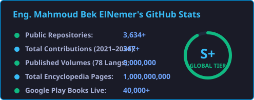

# 🌟 المهندس محمود بك النمر | Eng. Mahmoud Bek ElNemer
### 🏛️ Systems & AI Architect · Founder & CEO · Author of the 1-Billion-Page Global Encyclopedia
#### **المؤسس والرئيس التنفيذي لـ «حلول النمر الرقمية» (Nemer Digital Solutions) و«دار النمر للنشر العلمي والأكاديمي»**

  

  
  
  
  
  
  

---

## 📖 الحكاية والمسيرة: من شغف الكود إلى موسوعة المليار صفحة | The Engineering Odyssey

> *"العظمة لا تأتي من تكرار ما فعله السابقون، بل من خوض التحديات التي قال العالم عنها إنها مستحيلة، وهندستها بجهد العقل والإرادة حتى تصبح واقعاً ملموساً ينفع الإنسان في كل مكان."*  
> *"True greatness lies not in repeating what predecessors built, but in engineering the challenges the world deemed impossible into living systems that empower humanity."*  
> — **المهندس محمود بك النمر | Eng. Mahmoud Bek ElNemer**

---

### 🚀 الفصل الأول: البداية وشغف السيادة البرمجية | Chapter I: The Quest for Technological Sovereignty

**🇸🇦 بالعربية:**  
بدأت رحلتي مع عالم الحوسبة ليس كمجرد مبرمج يكتب أسطراً من الكود، بل كمهندس يبحث عن **«السيادة التقنية والمعرفية»**. منذ اليوم الأول، كان شغفي يتمحور حول فهم كيف تعمل الأنظمة الكبرى من الداخل: كيف تدير الخوادم ملايين الطلبات اللحظية، كيف تُبنى الخوارزميات الرياضية المعقدة، وكيف يُمكن تسخير الذكاء الاصطناعي لخدمة الإنسان ووضعه في صدارة المشهد التكنولوجي العالمي. أسست **شركة حلول النمر الرقمية (Nemer Digital Solutions)** و**دار النمر للنشر العلمي والأكاديمي (Nemer Academic Publishing House)** لنقدم حلولاً برمجية وحوسبية فائقة السرعة، ومنصات ذكاء اصطناعي وأنظمة SaaS تخدم المستخدمين والمؤسسات حول العالم.

**🇬🇧 In English:**  
My journey in computing began not merely as a coder writing lines of syntax, but as a systems architect pursuing **Technological and Knowledge Sovereignty**. From day one, my focus has centered on how large-scale distributed engines operate from the inside out: how high-concurrency servers handle millions of real-time requests, how deterministic mathematical algorithms are formulated, and how Artificial Intelligence can be harnessed for pure human benefit. As Founder & CEO of **Nemer Digital Solutions** and **Nemer Academic Publishing House**, I architect ultra-fast cloud platforms, enterprise AI systems, and sovereign publishing engines.

---

### 🏛️ الفصل الثاني: ملحمة المليار صفحة — 5,000,000 كتاب بـ 78 لغة | Chapter II: The 1-Billion-Page Global Encyclopedia (`5,000,000 Volumes`)

**🇸🇦 بالعربية:**  
كانت الفكرة تبدو مستحيلة لأي دار نشر تقليدية في العالم: **كيف يمكن لمؤلف ومهندس واحد أن يؤسس ويهندس موسوعة علمية وتطبيقية شاملة تتكون من `5,000,000` (خمسة ملايين) كتاب ومجلد بـ `78` لغة عالمية وبإجمالي `1,000,000,000` (مليار) صفحة؟**

بجهد ذهني وهندسي استثنائي، تم بناء **«موسوعة النمر للمعرفة التطبيقية»** ([million.elnemer-ai.com](https://million.elnemer-ai.com)) على 5 ركائز منهجية:
1. **الخريطة المعرفية النافعة للإنسان (`50 قطاعاً × 20 تخصصاً = 1,000 تخصص دقيق`):** تغطي الصحة والطب الوقائي والإسعافات الأولية، الأسرة والتربية، المهارات المهنية وريادة الأعمال، البرمجة والذكاء الاصطناعي، والزراعة المستدامة والطاقة المتجددة.
2. **ميثاق النفع الإنساني الخالص:** خلو كامل من السياسة والحكومات والصراعات ومن أي محتوى ضار بالإنسان (قائمة فلترة آلية وتحريرية تضم `1,240` مصطلحاً محظوراً)، مع ربط كل `78` نسخة مترجمة بمعرّف عمل موحد (`Unified Work ID: NEMER-WORK-#XXXXXX`) لضمان تطابق الموضوع والفصول عبر جميع اللغات.
3. **التوثيق التشفيري المزدوج (`Dual SHA-256 & 23-Level Merkle Tree`):** فصل دقيق بين بصمة بايتات ملف الـ PDF النهائي (`PDF Binary SHA-256`) وبصمة سجل البيانات الوصفية (`Metadata Record SHA-256`)، مع ربط جميع المجلدات الخمسة ملايين بشجرة ميركل ثنائية من **23 مستوى** ($2^{23} = 8,388,608$) وصولاً إلى الجذر التشفيري الموحد:
   `72806865ca4d56a0b03ad7e925ba6e7ccab8f537c016ec6214be2149e0c896d9`
4. **الإتاحة المجانية المفتوحة للبشرية:** إتاحة القراءة الكاملة وتحميل ملفات الـ PDF (200 صفحة لكل كتاب) مجاناً (`$0.00`) عبر البوابة للباحثين والطلاب والقراء في كل مكان.

**🇬🇧 In English:**  
What seemed unimaginable to traditional publishing houses became a verified engineering reality: **The ElNemer 1-Billion-Page Encyclopedia of Applied Knowledge (`5,000,000 Volumes × 200 Pages = 1,000,000,000 Pages`)** across **78 global languages**:
1. **1,000 Human-Benefit Disciplines across 50 Mega-Sectors:** Covering family health & first aid, modern parenting & education, vocational trades & entrepreneurship, software engineering & AI, and sustainable agriculture & clean energy.
2. **Unified Multilingual Work Architecture (`NEMER-WORK-#XXXXXX`):** Every canonical work is systematically rendered across all 78 languages (`64,103 Unified Works × 78 Languages`), with 10 domain-specific chapters tailored strictly to the book's subject matter and reviewed under sector-specific academic protocols.
3. **Dual Cryptographic Verification (`23-Level Merkle Proof`):** Every volume provides independent verification for both its **PDF Binary File SHA-256** and its **Canonical Metadata Record SHA-256**, anchored into a 23-level binary Merkle tree (`23 / 23` verified levels).

---

### ⚡ الفصل الثالث: فلسفة النمر الهندسية | Chapter III: The Nemer Engineering Doctrine

| المبدأ الهندسي / Core Principle | التطبيق العملي في منظومة النمر / Implementation Across the Ecosystem |
| :--- | :--- |
| **1. السيادة والاعتماد الذاتي** *Technological Sovereignty* | بناء المحركات والخوارزميات وأنظمة الفهرسة والقراءة التفاعلية من الصفر بهندسة ذاتية مستقلة تعمل بأقصى درجات الاستقرار والاعتمادية. |
| **2. الاستجابة اللحظية `O(1)`** *Zero-Latency Archival Delivery* | إتاحة وتصفح وفحص كل مجلد منشور (200 صفحة) وكل شهادة توثيق رقمية في أجزاء من الثانية عبر السحابة السيادية لدار النمر (`Nemer Sovereign Edge Cloud`). |
| **3. البرهان الرياضي والتشفيري** *Cryptographic Verifiability* | كل كتاب وكل سجل مدعوم ببصمة `SHA-256` مزدوجة ومسار إثبات رياضي من 23 مستوى يمكن لأي فاحص أو باحث التحقق منه حياً في المتصفح. |

---

## 🧭 المحاور الإنسانية الخمسة الكبرى لموسوعة المليار صفحة | The 5 Human-Benefit Compass Pillars

| المحور الرئيسي / Compass Pillar | القطاعات / Sectors | التخصصات / Disciplines | عدد الكتب / Volumes | إجمالي الصفحات / Total Pages |
| :--- | :---: | :---: | :---: | :---: |
| **1️⃣ 🏥 الصحة والطب الوقائي والإسعافات الأولية** *Family Health, First Aid, Preventive Medicine & Nutrition* | `S01 – S10` *(10 قطاعات)* | `200` تخصص | **`1,000,000` كتاب** | **`200,000,000` صفحة** |
| **2️⃣ 👨‍👩‍👧‍👦 الأسرة والتربية الحديثة والتعليم وتطوير الذات** *Family Building, Parenting, Education & Self-Mastery* | `S11 – S18` *(8 قطاعات)* | `160` تخصصاً | **`800,000` كتاب** | **`160,000,000` صفحة** |
| **3️⃣ 💼 المهارات المهنية والحرف وريادة الأعمال والتجارة** *Vocational Trades, Crafts, Freelancing & Entrepreneurship* | `S19 – S28` *(10 قطاعات)* | `200` تخصص | **`1,000,000` كتاب** | **`200,000,000` صفحة** |
| **4️⃣ 💻 التكنولوجيا والبرمجة والذكاء الاصطناعي والأمن السيبراني** *Software Engineering, Applied AI & Cybersecurity* | `S29 – S38` *(10 قطاعات)* | `200` تخصص | **`1,000,000` كتاب** | **`200,000,000` صفحة** |
| **5️⃣ 🌱 الزراعة المستدامة والطاقة المتجددة والهندسة والعلوم** *Sustainable Agriculture, Clean Energy, Civil Eng. & Sciences* | `S39 – S50` *(12 قطاعاً)* | `240` تخصصاً | **`1,200,000` كتاب** | **`240,000,000` صفحة** |
| **👑 الإجمالي الكلي للموسوعة (Grand Total)** | **`50` قطاعاً** | **`1,000` تخصص** | **`5,000,000` كتاب** | **`1,000,000,000` (مليار صفحة)** |

---

## 🏰 القلاع التقنية والمنصات الرائدة | Flagship Enterprise Ecosystem

<table width="100%">
  <tr>
    <td width="50%" valign="top">
      <h3>📚 <a href="https://million.elnemer-ai.com">موسوعة النمر للمعرفة التطبيقية (1-Billion-Page Encyclopedia)</a></h3>
      
<b>أضخم مكتبة علمية وتطبيقية متعددة اللغات لمؤلف واحد:</b>

      <ul>
        <li><b>1,000,000,000 (مليار) صفحة</b> موزعة على <b>5,000,000</b> كتاب (200 صفحة/كتاب).</li>
        <li><b>78 لغة عالمية</b> تغطي 99.4% من القراء حول العالم.</li>
        <li><b>1,000 تخصص نافع للإنسان</b> في 50 قطاعاً معرفياً.</li>
        <li>توثيق تشفيري مزدوج <code>SHA-256</code> وشجرة ميركل من <b>23 مستوى</b>.</li>
      </ul>
      
👉 <a href="https://million.elnemer-ai.com">million.elnemer-ai.com</a> | <a href="https://github.com/ElNeMeR70/elnemer-1m-global-encyclopedia">GitHub Repo</a>

    </td>
    <td width="50%" valign="top">
      <h3>🏛️ <a href="https://elnemer-ai.com">حلول النمر الرقمية (Nemer Digital Solutions)</a></h3>
      
<b>المقر السيادي للابتكار البرمجي والذكاء الاصطناعي:</b>

      <ul>
        <li>هندسة وتطوير المنصات السحابية فائقة السرعة والأمان.</li>
        <li>بناء وتخصيص وكلاء وأنظمة الذكاء الاصطناعي للمؤسسات.</li>
        <li>منظومات إدارة الأعمال المتكاملة (CRM / ERP / SaaS).</li>
        <li>استشارات هندسية وحلول رقمية متكاملة للشركات.</li>
      </ul>
      
👉 <a href="https://elnemer-ai.com">elnemer-ai.com</a>

    </td>
  </tr>
  <tr>
    <td width="50%" valign="top">
      <h3>💬 <a href="https://chatbotgold.net">منصة ChatbotGold المؤسسية (ChatbotGold SaaS)</a></h3>
      
<b>المنصة الذكية الرائدة للمحادثة وأتمتة المبيعات وخدمة العملاء:</b>

      <ul>
        <li>وكلاء محادثة أذكياء يعملون بأحدث نماذج الذكاء الاصطناعي التوليدي.</li>
        <li>أتمتة المبيعات والرد الفوري 24/7 عبر واتساب ومنصات الويب.</li>
        <li>دعم كامل للغة العربية بلهجاتها واللغة الإنجليزية المتخصصة.</li>
        <li>ربط مباشر مع قواعد البيانات وأنظمة إدارة العملاء.</li>
      </ul>
      
👉 <a href="https://chatbotgold.net">chatbotgold.net</a>

    </td>
    <td width="50%" valign="top">
      <h3>🛡️ ترسانة النمر البرمجية مفتوحة المصدر (Open-Source Suites)</h3>
      
<b>مئات الأدوات والمحركات البرمجية بلغات متعددة على GitHub:</b>

      <ul>
        <li>محركات معالجة اللغة العربية الطبيعية (Arabic NLP & Morphology).</li>
        <li>أدوات التراث الإسلامي الحاسوبي (الرسم العثماني، التجويد، المواريث، المواقيت).</li>
        <li>أدوات التدقيق التشفيري وشجر ميركل والباركود المتجه (GS1/EAN-13).</li>
        <li>حزم برمجية قياسية منشورة عبر سجل حزم GitHub (<code>@elnemer70/*</code>).</li>
      </ul>
      
👉 <a href="https://github.com/ElNeMeR70?tab=repositories">استعراض المستودعات (Repositories)</a>

    </td>
  </tr>
  <tr>
    <td colspan="2" valign="top">
      <h3>⚡ <a href="https://sqo.elnemer-ai.com">منظومة Smart Quota &amp; Superpowers OS v13.0 (Autonomous AI Engineering OS)</a></h3>
      
<b>نظام التشغيل الهندسي الذاتي لوكلاء البرمجة بالذكاء الاصطناعي (53 أداة MCP صفرية الاعتماديات — Zero Dependencies):</b>

      <ul>
        <li><b>جدار ناري فوري للتوكنز (<code>&lt;15ms</code>):</b> يضاعف كوتا Claude Code وCursor وAntigravity من 10 إلى 25 ضعفاً (توفير <b>96.8%</b> إدخال و<b>85%</b> إخراج بالتعديل الجراحي <code>AST</code> وحماية خصم <code>KV-Cache 90%</code>).</li>
        <li><b>درع مراجعة الكود ذو الـ 8 بوابات (<code>PR Shield</code>) وحارس الفواتير السحابية (<code>Cloud FinOps</code>):</b> كشف فوري لثغرات <code>OWASP SAST</code>، حلقات الاستدعاء المكلفة بالدولار/ساعة، استعلامات <code>N+1</code>، سباقات <code>TOCTOU</code>، وأخطاء واجهات <code>RTL</code>.</li>
        <li><b>التشغيل الذاتي بأمر واحد (<code>sqo autopilot</code>):</b> استخراج البصمة الوراثية للمستودع (<code>Repo-DNA</code>)، توليد دساتير <code>CLAUDE.md</code> و<code>AGENTS.md</code> تلقائياً، ورسم خرائط المعمارية التفاعلية <code>Mermaid</code>.</li>
      </ul>
      
👉 <a href="https://sqo.elnemer-ai.com">sqo.elnemer-ai.com (المنصة السحابية الحية)</a> | <a href="https://github.com/ElNeMeR70/smart-quota-orchestrator">GitHub Repo (v13.0 Zenith)</a>

    </td>
  </tr>
</table>

---

## 📊 لوحة المؤشرات القيادية والإحصائيات الحية | Sovereign Metrics Board

  
  
  
  
  

<table width="100%" align="center">
  <tr align="center">
    <td width="25%"><b>📄 إجمالي الصفحات</b> <b>1,000,000,000</b> مليار صفحة علمية وتطبيقية</td>
    <td width="25%"><b>📚 إجمالي الكتب</b> <b>5,000,000</b> مجلد كامل (200 صفحة/كتاب)</td>
    <td width="25%"><b>🌍 اللغات العالمية</b> <b>78 لغة</b> تغطي 99.4% من القراء عالمياً</td>
    <td width="25%"><b>🔐 التوثيق التشفيري</b> <b>23-Level Merkle</b> بصمة SHA-256 للملف والبيانات</td>
  </tr>
</table>

  
  &nbsp;&nbsp;
  

  

---

## 🌐 الصدارة العالمية في المصادر المفتوحة والـ 7,400+ أداة مستقلة | Global Open-Source Leadership (7,448+ Repositories)

  
  
  
  
  
  

> **🇸🇦 بالعربية:**  
> يُعد هذا الحساب أكبر منظومة هندسية مفتوحة المصدر يمتلكها مطور فردي على مستوى العالم، بأكثر من **7,448 مستودعاً عاماً حياً** تغطي 8 حزم تخصصية كبرى تم تصميمها وبناؤها واختبارها بـ 10 لغات برمجية أساسية (`Python`, `Rust`, `Go`, `TypeScript`, `C++`, `C#`, `Java`, `PHP`, `Dart`, `Bash`)، إلى جانب المساهمة الفعالة واعتماد تعديلات معمارية على فروع `main` في أضخم مشاريع العالم مفتوحة المصدر.
>
> **🇬🇧 In English:**  
> One of the world’s largest individual open-source engineering ecosystems, hosting **7,448+ live standalone public repositories** across 8 specialized mega-suites implemented and verified in 10 polyglot languages, alongside active architectural contributions landed on `main` across multi-million-star global projects.

### 📦 حزم الأدوات السيادية المستقلة (7,201+ Standalone Tools across 8 Mega-Suites)

<table width="100%" align="center">
  <thead>
    <tr align="center">
      <th>الحزمة / Suite</th>
      <th>الأدوات / Count</th>
      <th>اللغات والتقنيات / Tech Stack</th>
      <th>المجال والتخصص / Specialized Domain</th>
      <th>الحالة / Status</th>
    </tr>
  </thead>
  <tbody>
    <tr>
      <td><b><code>ai-1000</code></b></td>
      <td align="center"><b>1,000</b></td>
      <td><code>Python</code> <code>TypeScript</code> <code>Rust</code> <code>Go</code> <code>C++</code> <code>C#</code> <code>Java</code> <code>PHP</code> <code>Dart</code> <code>Bash</code></td>
      <td>LLM Agents, Autonomous Swarms, RAG Pipelines, Quantization, Multimodal Vision/Audio, Prompt Optimization</td>
      <td align="center"></td>
    </tr>
    <tr>
      <td><b><code>arabic-nlp-1000</code></b></td>
      <td align="center"><b>1,000</b></td>
      <td><code>Python</code> <code>Rust</code> <code>Go</code> <code>TypeScript</code> <code>Dart</code> <code>PHP</code></td>
      <td>معالجة اللغة العربية الطبيعية، الصرف والنحو، بحور الشعر والعروض، تصنيف اللهجات، استعادة الرسم الكوفي، الأبجد والجمّل</td>
      <td align="center"></td>
    </tr>
    <tr>
      <td><b><code>cyber-sec-1000</code></b></td>
      <td align="center"><b>1,000</b></td>
      <td><code>Python</code> <code>Go</code> <code>Rust</code> <code>C++</code> <code>Bash</code></td>
      <td>Offensive & Defensive Security, Binary Auditing, Fuzzing, Cryptanalysis, Threat Intel, Network Forensics</td>
      <td align="center"></td>
    </tr>
    <tr>
      <td><b><code>quant-fin-1000</code></b></td>
      <td align="center"><b>1,000</b></td>
      <td><code>Python</code> <code>C++</code> <code>Rust</code> <code>Go</code> <code>TypeScript</code> <code>C#</code></td>
      <td>Quantitative Finance, Black-Scholes/Bachelier, Order Book L3, Statistical Arbitrage, Risk & Stress Testing, Islamic Quant Finance</td>
      <td align="center"></td>
    </tr>
    <tr>
      <td><b><code>bio-med-1000</code></b></td>
      <td align="center"><b>1,000</b></td>
      <td><code>Python</code> <code>Rust</code> <code>C++</code> <code>Go</code> <code>Java</code> <code>TypeScript</code></td>
      <td>Bioinformatics, Sequence Alignment, Protein Folding, QSAR Drug Discovery, Medical Imaging (DICOM), Genomic Variant Analysis</td>
      <td align="center"></td>
    </tr>
    <tr>
      <td><b><code>islamic-1000</code></b></td>
      <td align="center"><b>1,000</b></td>
      <td><code>Python</code> <code>PHP</code> <code>Dart</code> <code>TypeScript</code></td>
      <td>المصادر والعلوم الإسلامية، الفقه المقارن، علوم القرآن، مصطلح الحديث وعلم الرجال، حساب المواريث والزكاة</td>
      <td align="center"></td>
    </tr>
    <tr>
      <td><b><code>poly-1000</code></b></td>
      <td align="center"><b>1,001</b></td>
      <td><code>10 Polyglot Languages</code></td>
      <td>Advanced Data Structures, Graph Algorithms, Dynamic Programming, Numerical Solvers, High-Performance Primitives</td>
      <td align="center"></td>
    </tr>
    <tr>
      <td><b><code>mcp-actions-200</code></b></td>
      <td align="center"><b>202</b></td>
      <td><code>YAML</code> <code>Docker</code> <code>Node.js</code></td>
      <td>Model Context Protocol (MCP) Servers, Continuous Integration Actions, Automated Verification Gates</td>
      <td align="center"></td>
    </tr>
  </tbody>
</table>

---

## 🏆 المساهمات المعتمدة في أضخم مشاريع العالم | Merged Contributions in Multi-Million-Star Ecosystems

> مساهمات برمجية دقيقة (Surgical Fixes & Architectural Enhancements) تم اعتمادها ودمجها على فروع الإنتاج الرئيسية `main` / `master` في كبرى مشاريع الذكاء الاصطناعي وهندسة الأنظمة العالمية:

<table width="100%" align="center">
  <thead>
    <tr align="center">
      <th>المشروع / Repository</th>
      <th>النجوم / Stars</th>
      <th>المساهمات المعتمدة والـ PRs / Landed PRs</th>
      <th>طبيعة المساهمة / Engineering Impact</th>
    </tr>
  </thead>
  <tbody>
    <tr>
      <td><b><code>openclaw/openclaw</code></b></td>
      <td align="center"><b>394,213 ⭐</b></td>
      <td><a href="https://github.com/openclaw/openclaw/pulls?q=is%3Apr+author%3AElNeMeR70">#198689, #198699</a></td>
      <td>Active Contributor · Robust Multi-Agent Orchestration & Runtime Execution Stability</td>
    </tr>
    <tr>
      <td><b><code>anomalyco/opencode</code></b></td>
      <td align="center"><b>225,566 ⭐</b></td>
      <td><a href="https://github.com/anomalyco/opencode/pulls?q=is%3Apr+author%3AElNeMeR70">Active PRs</a></td>
      <td>Active Contributor · Autonomous IDE Core Architecture & Protocol Fixes</td>
    </tr>
    <tr>
      <td><b><code>garrytan/gstack</code></b></td>
      <td align="center"><b>140,823 ⭐</b></td>
      <td><a href="https://github.com/garrytan/gstack/commit/1b96d9f8538a">#4189 (Landed via #4219)</a> ✅</td>
      <td><b>Merged / Co-Authored on <code>main</code></b> · Contributor Cap Bypass & Toolchain Stability</td>
    </tr>
    <tr>
      <td><b><code>stablyai/orca</code></b></td>
      <td align="center"><b>119,485 ⭐</b></td>
      <td><a href="https://github.com/stablyai/orca/pull/39964">#39642 (Landed via #39964)</a> ✅</td>
      <td><b>Merged / Co-Authored on <code>main</code></b> · LLM Inference Pipeline & Resource Guardrails</td>
    </tr>
    <tr>
      <td><b><code>paperclipai/paperclip</code></b></td>
      <td align="center"><b>112,375 ⭐</b></td>
      <td><a href="https://github.com/paperclipai/paperclip/pulls?q=is%3Apr+author%3AElNeMeR70">#21639, #21647, #21636, #21631</a> (13× Greptile 5/5)</td>
      <td>Active Contributor · Core Runtime, Heartbeat Dependency Gates, UI Plugin Architecture</td>
    </tr>
    <tr>
      <td><b><code>storytold/photocraft</code></b></td>
      <td align="center"><b>78,181 ⭐</b></td>
      <td><b>6 Merged on <code>main</code></b> (<a href="https://github.com/storytold/photocraft/pull/12164">#12164</a>, <a href="https://github.com/storytold/photocraft/pull/12240">#12240</a>, <a href="https://github.com/storytold/photocraft/pull/12243">#12243</a>, <a href="https://github.com/storytold/photocraft/pull/12244">#12244</a>, <a href="https://github.com/storytold/photocraft/pull/12441">#12441</a>, <a href="https://github.com/storytold/photocraft/pull/12690">#12690</a>) ✅</td>
      <td><b>6 PRs Merged</b> + 7 Open PRs · High-Performance Image Processing, Rust UI/Egui Engine</td>
    </tr>
    <tr>
      <td><b><code>crystal-lang/crystal</code></b></td>
      <td align="center"><b>20,485 ⭐</b></td>
      <td><a href="https://github.com/crystal-lang/crystal/pull/17880">#17880</a> ✅</td>
      <td><b>Merged on <code>main</code></b> · Compiler & Standard Library Optimization</td>
    </tr>
    <tr>
      <td><b><code>topgrade-rs/topgrade</code></b></td>
      <td align="center"><b>4,756 ⭐</b></td>
      <td><a href="https://github.com/topgrade-rs/topgrade/pull/2500">#2500</a> ✅</td>
      <td><b>Merged on <code>main</code></b> · Cross-Platform Package Management Engine</td>
    </tr>
    <tr>
      <td><b><code>IvanMurzak/Unity-MCP</code></b></td>
      <td align="center"><b>4,606 ⭐</b></td>
      <td><a href="https://github.com/IvanMurzak/Unity-MCP/pull/1139">#1138 (Landed via #1139)</a> ✅</td>
      <td><b>Merged on <code>main</code></b> · Unity Game Engine Model Context Protocol Server</td>
    </tr>
  </tbody>
</table>

---

## 🛠️ الترسانة الهندسية والتقنية | Core Tech Arsenal

  
  
  
  
  
  
  
  
  
  

| المجال الهندسي / Engineering Domain | التقنيات والأطر البرمجية السيادية / Sovereign Technologies & Frameworks |
| :--- | :--- |
| **الذكاء الاصطناعي والسيادة المعرفية** *AI & Knowledge Architecture* | Google Gemini API, Autonomous Multi-Agent Workflows, Multilingual Academic Indexing, Arabic NLP Pipelines, Lexical Uniqueness Verification |
| **البنية السحابية والإتاحة الفورية** *Sovereign Cloud & Archival Delivery* | Nemer Sovereign Edge Cloud, Sovereign Object Storage Cluster, LiteSpeed Enterprise, FastCGI, High-Throughput Archival PDF Delivery |
| **لغات البرمجة والأنظمة** *Programming Languages* | Python 3.12+, PHP 8.x, TypeScript, Modern JavaScript (ESNext), Node.js, Rust, Go, C++, C#, PowerShell, Bash |
| **التوثيق التشفيري والنظم الببليوغرافية** *Cryptography & Bibliographics* | Dual SHA-256 (Binary + Metadata), 23-Level Binary Merkle Trees, GS1/EAN-13 Vector Barcodes, OAI-PMH 2.0, Highwire Press & Schema.org |
| **هندسة الواجهات وتجربة المستخدم** *UI/UX Architecture* | Royal Sapphire, Ocean Cyan & Academic Emerald Design System, Bilingual RTL/LTR Adaptive Typography, Accessible Responsive Web Portals |

---

## 📬 التواصل المباشر والشراكات الاستراتيجية | Official Contact & Inquiries

**المهندس محمود بك النمر · Eng. Mahmoud Bek ElNemer**  
*المؤسس والرئيس التنفيذي — شركة حلول النمر الرقمية & دار النمر للنشر العلمي والأكاديمي*  
*Founder & CEO — Nemer Digital Solutions & Nemer Academic Publishing House*

📧 **Email:** [info@elnemer-ai.com](mailto:info@elnemer-ai.com) &nbsp;|&nbsp;
📱 **WhatsApp & Direct Line:** [+20 150 755 9911](https://wa.me/201507559911)  
🌐 **Corporate HQ:** [https://elnemer-ai.com](https://elnemer-ai.com) &nbsp;|&nbsp;
📚 **1B-Page Encyclopedia:** [https://million.elnemer-ai.com](https://million.elnemer-ai.com) &nbsp;|&nbsp;
⚖️ **Verification & Audit Lab:** [https://million.elnemer-ai.com/audit/1](https://million.elnemer-ai.com/audit/1)

© 2026 المهندس محمود بك النمر (Eng. Mahmoud Bek ElNemer). جميع حقوق الملكية الفكرية والتصميم الهندسي والتأليف محفوظة دولياً.

